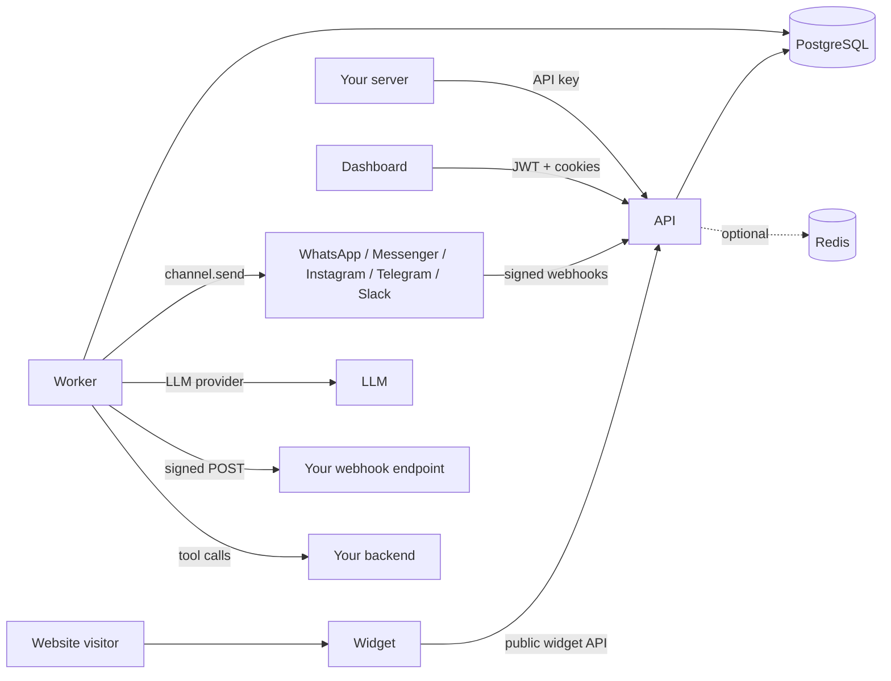

This section is for engineers who integrate with Lumi or extend it: calling the API, receiving webhooks, embedding the widget, or exposing their own backend to an agent as a tool. If you only configure agents in the dashboard, start with the guides instead.

## Components

| Component | What it does | Notes |
|---|---|---|
| **API** (`apps/api`) | HTTP server for the dashboard, the public API, the public widget API, provider webhooks and realtime sockets. | Base path `/api/v1`. Bun + Hono. |
| **Worker** (`apps/worker`) | Runs background jobs: AI replies, channel delivery, knowledge ingestion, webhook delivery, GDPR, billing and maintenance loops. | Needs the same `ENCRYPTION_KEY` as the API. |
| **Dashboard** (`apps/dashboard`) | The web app your team uses. Talks to the API with a short-lived access token. | |
| **Widget** (`apps/widget`) | The chat bubble you embed on your website. Renders in a Shadow DOM. | See [Widget embed](/developers/widget-embed). |
| **PostgreSQL** | System of record, the job queue (`jobs` table), realtime fan-out (`LISTEN/NOTIFY`) and tenant isolation (row-level security). | Required. |
| **Redis** | Optional. Shared rate-limit counters and typing/presence fan-out across several API instances. | Without `REDIS_URL`, the API uses an in-memory limiter and Postgres `NOTIFY`. |

If the diagram does not render in your viewer, read it as: clients and channels talk to the **API**; the API and the **worker** share **PostgreSQL**; only the worker calls the LLM provider, your webhook endpoints and your tool backends.

## Request flow

1. A client calls `/api/v1/...`. Middleware assigns a request id (`X-Request-Id`), resolves the client IP, applies security headers, CORS, the body-size cap and the global rate limit (300 requests per minute per IP).
2. Authentication identifies the **tenant** from a signed token or API key, never from the body or path. See [Authentication](/developers/authentication).
3. The route validates a strict body, opens a transaction with `withTenant`, and runs queries through tenant-scoped repositories. Row-level security is the backstop. See [Multi-tenancy and security](/developers/multi-tenancy-and-security).
4. Failures return the standard error envelope. See [Errors](/developers/errors).

## The channel pipeline

Every conversation, whatever the channel, goes through the same path.

1. **Inbound.** A widget visitor posts to `/api/v1/public/widget/messages`, or a provider calls `/api/v1/webhooks/channels/:channel/:connectionId` (signature verified over the raw body). The API resolves or creates the contact and conversation and stores a `contact` message.
2. **Enqueue.** In the same transaction the API enqueues an `ai.respond` job. If a person has taken over, the job is skipped by the runtime unless the customer sent the resume keyword.
3. **AI turn.** The worker loads the published agent version, the conversation stage and the agent's skills, runs one turn, and stores the reply as an `ai` message. See [AI runtime](/developers/ai-runtime).
4. **Fan-out.** Database triggers fire on every message insert. They publish realtime events to dashboards and widgets, queue `message.created` webhook deliveries, and, for non-widget channels, enqueue `channel.send`.
5. **Outbound.** `channel.send` delivers the reply to the provider and records the result in `channel_deliveries`. Permanent failures (for example a closed 24-hour window) add a `system` message so agents see it.

Because events come from database triggers inside the writer's transaction, an event exists if and only if its change committed, regardless of which component wrote it.

## Deployment modes

`DEPLOYMENT_MODE` selects how the same code behaves.

| | `saas` (default) | `selfhosted` |
|---|---|---|
| Tenants | Many; public sign-up optional (`ALLOW_PUBLIC_SIGNUP`) | Exactly one, created at setup; sign-up never allowed |
| Billing and credits | Stripe billing routes mounted; credits charged and gated | Billing routes not mounted; usage recorded, never charged or gated |
| Platform admin | Separate admin service (not in this API) | Not included |
| Tool connection URLs | https required | http also allowed |

<Note>
`GET /api/v1/usage/credits` returns `enabled: false` on self-hosted deployments. Build integrations to tolerate that. See [Credits API](/developers/credits-api).
</Note>

## Choose an integration surface

| You want to... | Use |
|---|---|
| Read or write contacts, conversations, messages and bookings from your server | [Public API](/developers/public-api) with an API key |
| React to events (new message, handoff, booking) | [Webhooks](/developers/webhooks) |
| Put chat on your site | [Widget embed](/developers/widget-embed) |
| Stream live events to a custom UI | [Realtime](/developers/realtime) |
| Let the agent call your backend (order lookup, booking, CRM) | [Custom tools backend](/developers/custom-tools-backend) and [Tool manifest](/developers/tool-manifest) |
| Understand or debug agent behavior | [AI runtime](/developers/ai-runtime) |

The generated endpoint reference lives under the **API reference** tab. Conventions shared by every endpoint are in [API conventions](/developers/api-conventions).

{/* source: apps/api/src/app.ts, apps/api/src/config.ts, apps/api/src/middleware.ts, packages/ai-runtime/src/runtime.ts, packages/channels/src/send-job.ts, packages/db/migrations/0500_integrations.sql, deploy/Caddyfile, docs/api/conversations.md, docs/api/channels.md */}
